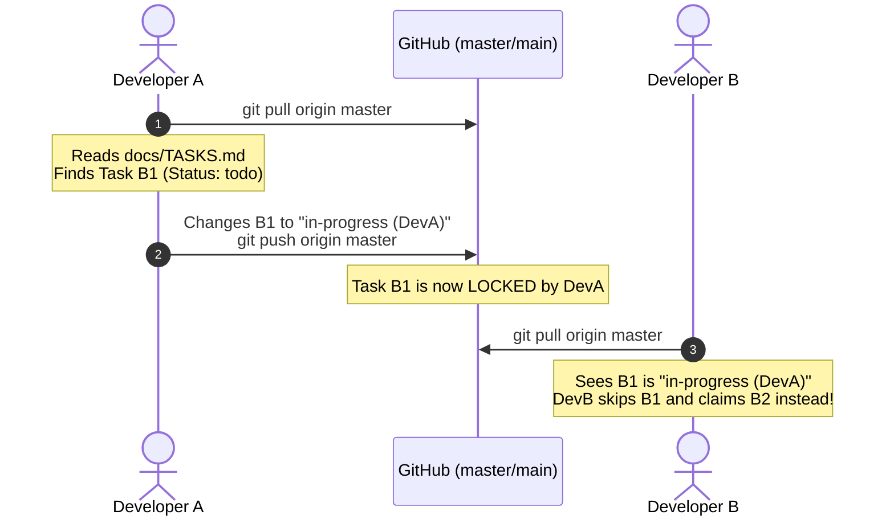

# DEVELOPER GUIDE

> How to pick up and finish a task across Phase 1 (Frontend) and Phase 2 (Backend). Read this once, then keep `docs/RULES.md` open while you work.

---

## Before you start (one time)

1. Get access to the GitHub repository and clone it.
2. Install dependencies:
   - Frontend: `npm install --prefix frontend`
   - Root / Backend: `npm install` (once backend is set up)
3. Check that everything passes on your machine:
   - `npm test --prefix frontend` (all 247 tests must pass before you change anything).
4. The project rules are loaded from `docs/RULES.md` and `.claude/` / `GEMINI.md`.
5. Read, in this order:
   - `docs/MEMORY.md` (what has been decided and completed)
   - `docs/TASKS.md` (the shared board)
   - `docs/RULES.md` (how we code and test)
   - `docs/ARCHITECTURE.md` (system layout and shared data contracts)
   - `docs/DESIGN.md` (UI rules, for frontend work)

---

## Multi-Developer Coordination & Task Claiming

To prevent developers and AI agents from colliding or duplicating effort, we use the **Task Claim Lock** in `docs/TASKS.md` against GitHub:



### How to claim a task:
1. **Pull the latest `master` / `main`**:
   ```bash
   git checkout master
   git pull origin master
   ```
2. **Find an unassigned task**: Check `docs/TASKS.md` for a row with `Status: todo` whose `Depends on` prerequisites are `done`.
3. **Lock the task**: Change the status column from `todo` to `in-progress (<YourName>)` (e.g. `in-progress (Tarun)`).
4. **Push your claim immediately**:
   ```bash
   git add docs/TASKS.md
   git commit -m "chore: claim task B1 (Tarun)"
   git push origin master
   ```
   *From this moment, all other developers and AI agents see that this task is locked.*

### What if two developers claim the same task simultaneously?
- Developer 1 pushes their claim commit first $\rightarrow$ succeeds.
- Developer 2 tries to push their claim commit $\rightarrow$ Git rejects it (`[rejected - fetch first]`).
- Developer 2 pulls (`git pull`), sees Developer 1 already claimed that task, and picks another available `todo` task. No collision!

### Preventing Merge Conflicts via Strict File Isolation
Every task on the board specifies an explicit list in the **Files** column:
- **Rule of File Isolation**: You must touch **ONLY** the files listed on your claimed row.
- If Developer A works on Task B2 (`backend/src/db/database.js`) and Developer B works on Task B3 (`backend/src/validators/titleValidator.js`), their changes are completely isolated. Both can develop in parallel and merge into `master` with **zero merge conflicts**.
- Need to touch a file not listed on your row? Coordinate with the lead to update `docs/TASKS.md` before editing.

---

## The 6-Step Task Lifecycle

1. **CLAIM**: Mark `in-progress (<YourName>)` in `docs/TASKS.md` and push to `master`.
2. **BRANCH**: Create a short-lived branch for the task:
   ```bash
   git checkout -b task/b1-scaffold-backend
   ```
3. **DEVELOP**:
   - Touch **only** the files assigned in `docs/TASKS.md`.
   - Write tests alongside the implementation (TDD).
   - Never alter the shared `Task` contract without owner approval.
4. **VERIFY**: Run all checks before pushing:
   - Frontend: `npm test --prefix frontend`, `npm run lint --prefix frontend`, `npm run build --prefix frontend`
   - Backend: `npm test` from `backend/`
   - All tests must pass; line coverage floor is 80%.
5. **PR & SQUASH-MERGE**:
   - Push your branch: `git push -u origin task/b1-scaffold-backend`
   - Open a GitHub Pull Request detailing the task ID, changes, and acceptance checks.
   - Squash-merge into `master` once approved and CI passes.
6. **CLOSE & RECORD**:
   - Set the task status to `done` in `docs/TASKS.md`.
   - Append one dated entry to `docs/MEMORY.md` describing what was implemented.
   - Update `docs/ARCHITECTURE.md` if any structural changes were introduced.
   - Push updates to `master`.

---

## Rules that are checked automatically

- **React Architecture**: Functional components and hooks only. One component per file, PascalCase file names, hooks start with `use`.
- **Service Isolation**: Browser storage (`localStorage`) and network requests (`fetch`/`axios`) live **strictly** within services (`frontend/src/services/` or `backend/src/services/`). Components and hooks never access storage or network APIs directly.
- **Validation**: Boundary validation is mandatory. Task titles must be trimmed and 1–200 characters.
- **Security & Integrity**: Plain text rendering (no `dangerouslySetInnerHTML`). No hardcoded secrets or environment variables committed.
- **Data Shape**: Fixed shared contract: `{ id, title, completed, createdAt, updatedAt }`. Do not alter this shape.
- **Error Handling**: Graceful error surfacing to the UI; no silent `catch` blocks.
- **Formatting & Linting**: Prettier formatting and ESLint must pass on both frontend and backend.

---

## Testing Standards

- Every new component, hook, or service function requires a **happy-path test plus at least two edge or error cases**.
- Frontend uses Vitest + React Testing Library + Axe accessibility checks (`frontend/src/test/axe.js`).
- Backend uses Vitest + Supertest for unit and route integration tests.
- **Coverage floor is 80% of lines**. Never weaken or skip tests to make a check pass.

---

## Current Task Board State

- **Phase 1 (Frontend)**: All units (`U1` to `U9`, `T1` to `T8`) are **done** (247 tests passing at ~98% coverage).
- **Phase 2 (Backend)**: In progress. Tasks available for claiming in `docs/TASKS.md`:

| ID | Task | Requirements | Assigned Files | Depends on |
|---|---|---|---|---|
| **B1** | Scaffold backend project (Express, SQLite, Vitest, Supertest) | BR-1, BR-2 | `backend/package.json`, `backend/src/app.js`, `backend/src/server.js` | - |
| **B2** | SQLite DB initialization and schema migration | BR-2 | `backend/src/db/database.js`, `backend/tests/database.test.js` | B1 |
| **B3** | Title validation rules (1-200 trimmed characters) | BR-3 | `backend/src/validators/titleValidator.js`, `backend/tests/titleValidator.test.js` | B1 |
| **B4** | Task CRUD service (data access layer) + tests | BR-1, BR-2 | `backend/src/services/taskService.js`, `backend/tests/taskService.test.js` | B2, B3 |
| **B5** | Express routes for `/api/tasks` + integration tests | BR-1, BR-4 | `backend/src/routes/taskRoutes.js`, `backend/tests/taskRoutes.test.js` | B4 |
| **B6** | Frontend service integration (taskStorage API connection) + Vite proxy | BR-5, BR-6 | `frontend/src/services/taskStorage.js`, `frontend/vite.config.js` | B5 |
| **B7** | End-to-end verification and full regression suite | all BR & FR | `frontend/`, `backend/` | B6 |
