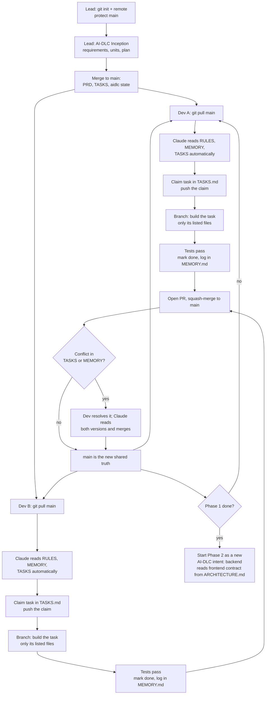
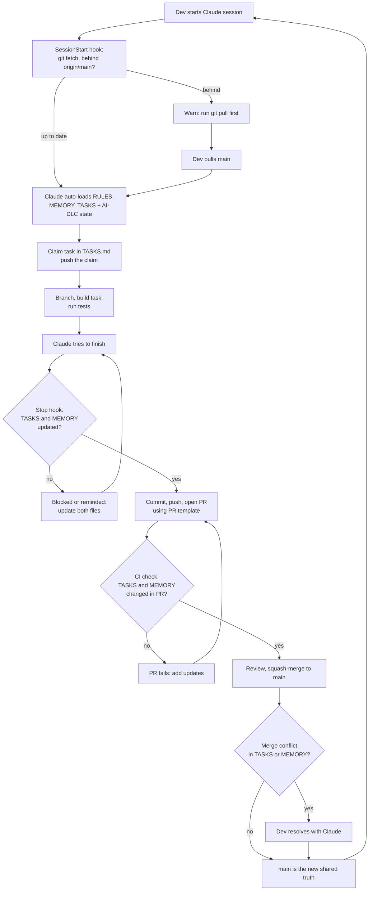

# FLOW: Multi-developer workflow with AI-DLC and Claude

> How several developers work on this project at the same time without conflicts or losing context. Read this once when you join. Keep it short; update it if the process changes.

## Core idea

Claude does not detect other developers' changes live. Every session starts blank and **reads the files in the repo**. Context is shared through git, so the repo files are the shared memory.

| File | What the next Claude learns from it |
|------|-------------------------------------|
| `MEMORY.md` | Decisions made and a dated log of changes |
| `TASKS.md` | What is done, in progress (and by whom), or still to do |
| `ARCHITECTURE.md` | Current structure and the `Task` data shape |
| `PRD.md` | What we are building (requirements and acceptance checks) |
| `DESIGN.md` | UI rules |
| `RULES.md` | How to work (loaded every session) |
| `aidlc/.../aidlc-state.md` | Which AI-DLC stage the work is in |
| `aidlc/.../audit/` | Log of every decision (one shard per clone) |

`RULES.md`, `MEMORY.md` and `TASKS.md` load automatically. The rest are read only when a task needs them, to save tokens.

## Overall flow

## Steps for a developer

1. `git pull` on `main`. Start a fresh Claude session (`/clear` between tasks).
2. Claude reads `MEMORY.md` and `TASKS.md`. Pick ONE task whose dependencies are `done`.
3. Set its status to `in-progress (your name)` in `TASKS.md`, commit and push that claim first.
4. Branch from `main`. Edit only the files listed on the task. Need another file? Add it to the task first.
5. Write the code and tests. Run the full test suite.
6. Set the task to `done` in `TASKS.md`. Append one dated line to `MEMORY.md`. Update `ARCHITECTURE.md` if structure changed.
7. Open a PR. Squash-merge into `main`.

## Roles

| Role | Does | Does not |
|------|------|----------|
| Lead (one person) | Runs AI-DLC Inception (requirements, units, plan), owns `PRD.md` and the `Task` data shape, starts Phase 2 | |
| Developer | Takes Construction tasks from `TASKS.md` | Run Inception stages, edit `PRD.md` or the data shape without the lead's approval |

## How conflicts are avoided

- **Separate files per task.** Each task lists the files it touches, and no two tasks share a file (one component per file).
- **Claim first.** Two developers claiming the same row cause a git conflict on that line, so it is caught early.
- **Dependencies.** A task starts only after the tasks it depends on are `done`.
- **Pull before each task.** This is how a developer's Claude sees the latest changes.

## Known risks

- `MEMORY.md` and `TASKS.md` are shared. Two PRs can touch the same lines. This gives small merge conflicts, not silent overwrites.
- AI-DLC keeps one "current stage" per intent in `aidlc-state.md`. Only the lead runs Inception. Behaviour of two people running AI-DLC Construction stages in one intent is untested; try it with two clones first.
- If someone skips step 6, the next Claude works from stale context. Check "TASKS and MEMORY updated" on every PR.

## Reducing token use

- Keep `RULES.md`, `MEMORY.md` and `TASKS.md` short. When `MEMORY.md` passes about 100 lines, summarise old entries.
- Use `/clear` between tasks; state is on disk.
- Use a light AI-DLC scope (`mvp`, `feature` or `express`), not `enterprise`.
- Read `PRD.md`, `ARCHITECTURE.md` and `DESIGN.md` only when the task needs them.

## Before a second developer joins

- [ ] `git init`, push to a shared remote, protect `main`
- [ ] Review `PRD.md` and `TASKS.md`
- [ ] Lead has finished AI-DLC Inception and merged it
- [ ] Each developer cloned the repo, ran `/aidlc --doctor`, and restarted Claude Code
- [ ] Two-clone test done on one small task

## Note: what to do when the second developer joins (NOT done yet, planned)

Today the project is solo, so nothing below is set up. Do these once, when developer #2 is about to start. Until then, ignore this section.

1. **Enable git.** Run `git init`, add a `.gitignore` (the AI-DLC block is already shipped), push to a shared remote, and protect `main` (PR required).
2. **Add a SessionStart hook** in `.claude/settings.json` that runs `git fetch` and warns if the local branch is behind `origin/main`. This removes the "forgot to pull" problem.
3. **Add a Stop hook** that reminds Claude (or blocks) when code changed but `TASKS.md` or `MEMORY.md` did not. This makes the update step close to enforced.
4. **Add a PR template and a CI check** that fail when `TASKS.md` or `MEMORY.md` is unchanged in a PR. This catches skipped updates at merge time.
5. **Onboard developer #2.** Clone the repo, run `/aidlc --doctor`, approve the hooks, restart Claude Code, then read this file.
6. **Run the two-clone test.** Both developers claim different tasks, build, and merge. Confirm `TASKS.md` and `MEMORY.md` merge cleanly and that AI-DLC state stays consistent.
7. **Confirm roles.** One lead owns Inception and `PRD.md`. Everyone else takes Construction tasks only.

### Flow after these changes

What changes compared with the flow above: the pull check at session start, the update check when Claude stops, and the CI check at the PR are automatic instead of habit.

