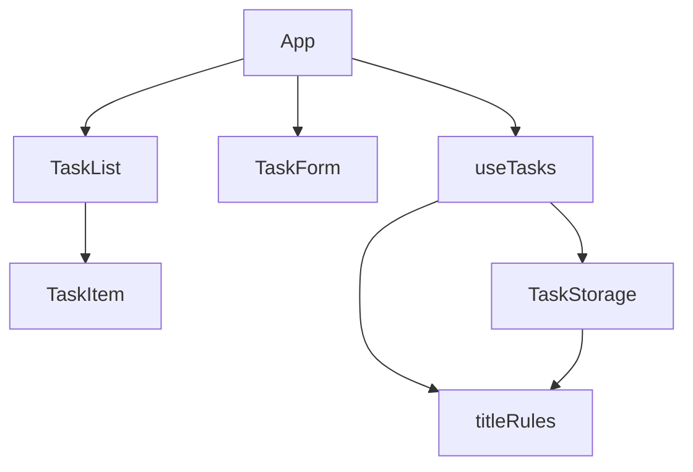

# Frontend Components: add-task (U1), Todo List Frontend (Phase 1)

## Sources

- [desc] Initial description: "Todo list frontend using basic React (phase 1 of 2; backend comes in phase 2)"
- [scope] Workflow-selected scope: `mvp`.
- Behaviour, rules and workflows: `functional-spec.md` in this folder (rules BR1.1 to BR1.15, workflows W1 to W6).
- Component catalogue and ADR-004: `aidlc/spaces/default/intents/261015-todo-frontend/inception/domain-design/components.md` and `decisions.md`
- Contracts C3 to C5: `aidlc/spaces/default/intents/261015-todo-frontend/inception/contract-design/contract-summary.md`
- Screens M1 to M3, M7 and the interaction spec: `aidlc/spaces/default/intents/261015-todo-frontend/inception/refined-mockups/mockups.md` and `interaction-spec.md`
- Team practices (JavaScript, React functional components and hooks, one component per file, PascalCase file names, hooks start with `use`): `aidlc/spaces/default/intents/261015-todo-frontend/inception/practices-discovery/team-practices.md`
- Answers recorded in `functional-design-questions.md` in this folder, cited as [Q1] to [Q5].

## Component hierarchy

Text fallback: `App` reads `useTasks` and renders `TaskForm` and `TaskList`; `TaskList` renders `TaskItem`; `useTasks` calls `TaskStorage` and the title rules; `TaskStorage` calls the title rules. No cycles. Only `App` reads the hook (ADR-004). Blocks that belong to later Units (FilterBar, Counter, DeleteDialog, MessageBar) are not part of this unit.

| Block | File | Kind | Job in this unit |
|-------|------|------|------------------|
| App | `src/App.jsx` | component | Page frame and title; reads the hook once; passes data and actions down; focus on the add input at page open |
| TaskForm | `src/components/TaskForm.jsx` | component | Add input, label, Add button, refusal message under the row |
| TaskList | `src/components/TaskList.jsx` | component | Renders the tasks newest first |
| TaskItem | `src/components/TaskItem.jsx` | component | One task row in display form: the title as plain text |
| useTasks | `src/hooks/useTasks.js` | hook | Holds `tasks` and `notice`; offers `add`; loads on start |
| TaskStorage | `src/services/taskStorage.js` | service | `load` (with shape check), `save` (whole list, all or nothing, backup copy), `checkTitle` delegating to the title rules |
| titleRules | `src/services/titleRules.js` | service | The title check as a pure function [Q3] |

File names follow the team practice and `docs/ARCHITECTURE.md`; the exact folder layout is confirmed in the Code Generation plan.

## Props, state and values

State lives only in `useTasks` (`tasks`, `notice`). `TaskForm` holds only the text being typed and the current message, which it derives from the `reason` of the result it gets back (a deviation from contract C5's `message` input, listed in the functional spec). Contract C5 otherwise fixes the inputs:

| Block | Inputs it receives | Calls |
|-------|--------------------|-------|
| TaskForm | `onAdd(rawTitle) -> { ok } or { ok: false, reason }` | `onAdd` on Enter or Add; reads and clears the input in one step (BR1.16) |
| TaskList | `tasks`, `hasTasks` | none in this unit |
| TaskItem | `task` | none in this unit |

`useTasks` returns, for this unit: `visibleTasks` (all tasks, because there is no filter yet), `hasTasks`, `notice`, and the action `add(rawTitle)`. The other values and actions of contract C4 (`remaining`, `filter`, `toggle`, `edit`, `remove`, `setFilter`) are added by later Units.

## Interaction flows

| Flow | Steps |
|------|-------|
| Add by keyboard | Focus is in the input on page open; type; Enter; the task appears at the top; input empty; focus still in input |
| Add by mouse | Type; press Add; same result |
| Refused add | Add or Enter with an empty or 201-character title; message under the row; text and focus stay |
| Reload | Page opens; tasks read back; input has focus |

## Form validation

| Check | When | Message | Text kept |
|-------|------|---------|-----------|
| Empty after trimming | On Add or Enter | "Please enter a task title." | The typed text (spaces) stays |
| More than 200 characters after trimming | On Add or Enter | "Title must be 200 characters or fewer." | Yes |
| Valid | On Add or Enter | none; the input is cleared | not applicable |

The message is cleared as soon as the person types again or after a successful add. The message is linked to the input and is announced to screen readers when it appears. `TaskForm` maps the `reason` it receives to the text; it does not decide the rule (BR1.2, BR1.3).

## Display rules

- A title is rendered as plain text, never as markup (BR1.5). With a library like React this means the title is passed as a child text node and never inserted as HTML.
- Long titles wrap over as many lines as needed and never overflow the card (screen M7); one unbroken word is allowed to break.
- The page frame follows M1: a centered card, 600 px maximum width, title "Todo List", then the add row, the message area and the list. The empty-list message, the browser-only line, the count and the filters are other Units.

## Accessibility (this unit)

| Requirement | Implementation |
|-------------|----------------|
| Label | The input has a visible label or the accessible name "Task title"; the placeholder "What needs to be done?" is not the only label |
| Keyboard | Tab to the input, type, Enter; Tab to Add, Enter or Space; visible focus ring (2 px, accent color) |
| Focus | Input has focus on page open and after a successful add [Q4]; it stays after a refused add |
| Messages | The refusal message uses a "(!)" mark as well as danger color, and is announced when it appears |
| Contrast | Text at least 4.5 to 1, using the colors in the design file |

## Integration points

There are none outside the browser. The only integration is the storage service (`TaskStorage`) that reads and writes the browser's local storage, which only `src/services/` may touch. No network request carries task data (NFR5).

## Project setup that belongs to this unit

These are build tasks rather than behaviour; they are listed so the Code Generation plan includes them:

- the project files for a React app in JavaScript;
- Prettier and ESLint configuration, both of which must pass (team hard rule);
- Vitest and React Testing Library, with a coverage report toward the 80% floor (NFR7);
- tests per layer in the team's order (storage and title rules, then the hook, then the components), each with the happy path and at least two edge or error cases.

## Assumptions & Open Questions

- [assumption] The file and folder names above follow `docs/ARCHITECTURE.md` and the team practices; the exact layout is fixed in the Code Generation plan.
- [assumption] The message under the add row is cleared when the person types again. Not specified by the mockups.
- [assumption] `TaskItem` shows only the title in this unit; the row layout (checkbox, buttons) arrives in U2, U3 and U4, and `TaskItem` is built so those fit without changing its inputs beyond adding the new ones.
- Open question: whether `TaskList` should be given `hasTasks` now even though the empty-list message is U9. Included in the inputs so U9 only adds the message.
