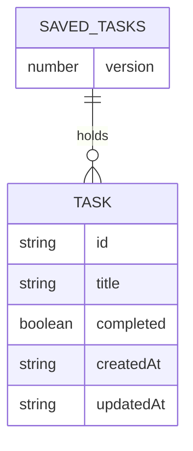

# Functional Specification: add-task (U1), Todo List Frontend (Phase 1)

## Sources

- [desc] Initial description: "Todo list frontend using basic React (phase 1 of 2; backend comes in phase 2)"
- [scope] Workflow-selected scope: `mvp`.
- Unit definition and boundaries (U1 add-task, story US1.1): `aidlc/spaces/default/intents/261015-todo-frontend/inception/units-generation/unit-of-work.md` and `unit-of-work-story-map.md`
- Requirements FR1.1 to FR1.7, FR6.1, FR6.2, FR6.3, NFR1, NFR4, NFR6, NFR8: `aidlc/spaces/default/intents/261015-todo-frontend/inception/requirements-analysis/requirements.md`
- Acceptance criteria AC1.1.1 to AC1.1.6: `aidlc/spaces/default/intents/261015-todo-frontend/inception/user-stories/stories.md`
- Component catalogue and decisions (ADR-001 to ADR-006): `aidlc/spaces/default/intents/261015-todo-frontend/inception/domain-design/components.md` and `decisions.md`
- Contracts C1 to C5: `aidlc/spaces/default/intents/261015-todo-frontend/inception/contract-design/contract-summary.md`
- Screens M1 to M3, M7 to M9: `aidlc/spaces/default/intents/261015-todo-frontend/inception/refined-mockups/mockups.md`
- Team practices (JavaScript, one component per file, storage only in `src/services/`): `aidlc/spaces/default/intents/261015-todo-frontend/inception/practices-discovery/team-practices.md`
- Bolt plan (B1 is the walking skeleton): `aidlc/spaces/default/intents/261015-todo-frontend/inception/delivery-planning/bolt-plan.md`
- Answers recorded in `functional-design-questions.md` in this folder, cited as [Q1] to [Q5].

## Purpose and scope

add-task is the **walking skeleton** (the thin end-to-end slice built first so the whole structure is proven before features are added). A person types a title, adds it, sees it at the top of the list, and finds it again after a reload. This document is the source of truth for the unit's workflows, the state it holds and the rules it follows. It is design only: no code.

In this unit:

- the page frame and title (`App`), the add row (`TaskForm`), the list and task rows in display form (`TaskList`, `TaskItem`), the state hook with the add action (`useTasks`), the storage service with load, save, and the title rules (`TaskStorage` and a title rules file);
- the project setup: formatting, linting and the test tools (these are build tasks, not behaviour; they are listed in `frontend-components.md`).

Not in this unit (they arrive in later Bolts): the checkbox, Edit and Delete buttons, the filter, the count, the browser-only line, the empty-list message, other-tab sync, unknown-version handling and unknown extra fields, and the message line that shows the notices (U6's `MessageBar`). U1 does produce the two storage notices as state, and checks the shape of saved data on load, so the first save behaves correctly (rules BR1.11 to BR1.14).

## Workflows

### W1. Open the page

1. `App` asks `useTasks` for its state; `useTasks` calls `TaskStorage.load()`.
2. If load returns tasks (or the saved list is simply absent), the list on screen is those tasks in saved order, newest first. An absent saved list is an empty list, not a failure.
3. If load returns `unreadable` or `blocked`, the list on screen is empty and the notice is `load-failed` (rules BR1.11, BR1.14).
4. The add input has focus (screen M1).

### W2. Add a task (happy path)

1. The person types a title and presses Enter, or presses Add (BR1.8).
2. `TaskForm` passes the typed text to the `add` action unchanged.
3. `add` asks the title rules to check the text (BR1.1 to BR1.3). The check trims leading and trailing spaces and returns the trimmed title.
4. `add` builds a task: a new unique id [Q5], the trimmed title, `completed` false, and one ISO 8601 time used for both `createdAt` and `updatedAt` (BR1.9).
5. `add` puts the task at the front of the list on screen, then asks `TaskStorage.save` with the whole list (BR1.7).
6. `add` returns `{ ok: true }`; `TaskForm` clears the input and keeps focus in it [Q4] (BR1.6).
7. If the save succeeded, any `save-failed` notice is cleared. If it failed, workflow W4 runs.

### W3. Add a task that is refused

1. Steps 1 to 3 of W2 run.
2. The title rules return `empty` (nothing left after trimming) or `too-long` (more than 200 characters after trimming).
3. `add` returns `{ ok: false, reason }`, changes nothing, and does not call `save`.
4. `TaskForm` shows the message for the reason under the add row: "Please enter a task title." for `empty`, "Title must be 200 characters or fewer." for `too-long` (BR1.2, BR1.3). The typed text stays and focus stays in the input.

### W4. A save fails

1. `TaskStorage.save` returns `{ ok: false, reason }` (`invalid-task`, `blocked`, `full` or `failed`).
2. The task stays on screen [Q1] and the notice becomes `save-failed`, whatever the notice was before (BR1.12). No other change is made.
3. The next successful save writes the whole list, including the task whose save failed, and clears the `save-failed` notice (BR1.12). If the data had also failed to load, the notice goes back to `load-failed`, because that message stays until reload.

### W5. First save after saved data could not be read

1. The notice is `load-failed` because load returned `unreadable` (W1 step 3). `TaskStorage` keeps the unreadable text it read, in memory, and is the only owner of this state.
2. When the person adds a task, W2 runs up to step 5. When `save` is called while it holds unreadable text that is not yet backed up, it first copies that text exactly as read to a backup storage name, then writes the new list [Q2] (BR1.13).
3. If the copy cannot be made (for example `full` or `blocked`), nothing else is written, the saved data stays as it was, and `save` returns `{ ok: false, reason }` with the reason of the failed copy; W4 then applies.
4. If the copy succeeds and the main write then fails, the backup stays, `save` returns `{ ok: false, reason }`, and `TaskStorage` remembers that the backup is done, so the next `save` does not copy again.
5. After the main write succeeds, `TaskStorage` forgets the unreadable text. The `load-failed` notice stays until the page is reloaded (screen M8).

### W6. Reload

The same as W1. The tasks added in W2 are read back with the same order, titles and `completed` values (FR6.2).

## State held

`useTasks` holds two values (nothing else is shared state):

| Value | Meaning | Starts as | Changes when |
|-------|---------|-----------|--------------|
| `tasks` | The list on screen, newest first; a copy of the saved list (ADR-006) | The loaded list, or empty | `add` puts a task at the front |
| `notice` | `null` or `{ kind, text }` with `kind` `load-failed` or `save-failed`; the text is fixed by `useTasks`: "Your tasks could not be loaded." and "Your change could not be saved." (screens M8, M9) | `null`, or `load-failed` after a failed load | See the state machine below |

`useTasks` also remembers, privately, whether the load failed (`loadFailed`), so it can return to `load-failed` after a failed save is cleared. `TaskStorage` holds no state shown on screen. After an `unreadable` load it keeps the unreadable text in memory (and whether it is backed up) until the main write succeeds; it is the only owner of that state.

### Notice state machine

Every pair of current notice and event has a row. Only one notice is shown at a time; `save-failed` outranks `load-failed` while it applies, because it is the newer problem and tells the person a change is not saved.

| From | Event | To |
|------|-------|----|
| `null` | load returns unreadable or blocked | `load-failed` |
| `null` | a save fails | `save-failed` |
| `null` | a save succeeds | `null` |
| `load-failed` | a save fails | `save-failed` |
| `load-failed` | a save succeeds | `load-failed` (stays until reload, as drawn in M8) |
| `save-failed` | a save fails | `save-failed` |
| `save-failed` | a save succeeds, and the load had not failed | `null` |
| `save-failed` | a save succeeds, and the load had failed | `load-failed` |

Text fallback: two notices, one shown at a time; a failed save always shows `save-failed`; a good save clears it, returning to `load-failed` only when the load had failed; `load-failed` itself clears only by reloading the page.

## Business rules

Each rule has a stable ID. The traceability file maps each acceptance criterion of US1.1 to these rules.

| ID | Category | Rule | Source |
|----|----------|------|--------|
| BR1.1 | validation | The title is trimmed of leading and trailing spaces before it is checked and before it is saved. | FR1.1, AC1.1.1 |
| BR1.2 | validation | If nothing is left after trimming, the add is refused with reason `empty` and the message "Please enter a task title."; the list is unchanged and nothing is saved. | FR1.3, AC1.1.2 |
| BR1.3 | validation | A title of 200 characters after trimming is accepted; one of 201 or more is refused with reason `too-long` and the message "Title must be 200 characters or fewer."; the typed text is kept and nothing is saved. The counting unit is the visible character: an emoji or a letter with an accent counts as one, so 200 visible characters are accepted whatever they are made of. The title rules are the only place that counts; `save` applies the same function again and cannot disagree. | FR1.1, FR1.4, AC1.1.3 |
| BR1.4 | constraint | Two tasks may have the same title; each is a separate task with its own id. | FR1.6, AC1.1.4 |
| BR1.5 | policy | A title is always shown as plain text. Text such as `<b>x</b>` is displayed as typed and is never run as markup. | NFR4, AC1.1.5 |
| BR1.6 | policy | A newly added task goes to the front of the list. After a successful add the input is cleared and keeps focus [Q4]; after a refused add the input keeps the text and the focus. | FR1.2, FR1.7, AC1.1.1 |
| BR1.7 | calculation | With 100 tasks on the list, the new task is shown on screen in under 100 ms after the add is submitted; the save does not delay what is shown. | NFR1, AC1.1.6 |
| BR1.8 | policy | Enter in the add input and the Add button do exactly the same thing, and the whole add works by keyboard alone. | FR1.5, AC1.1.1 |
| BR1.9 | constraint | A task has exactly five fields: `id`, `title`, `completed`, `createdAt`, `updatedAt`. The id is a new unique id made by `useTasks` [Q5]; the method is chosen in the Code Generation plan (the built-in unique id maker where the browser has it, with a time-plus-random-text fallback where it does not, such as a page opened over plain http on a network address). A new task has `completed` false, and `createdAt` and `updatedAt` hold the same ISO 8601 time. `TaskStorage` never makes ids or times. | NFR6, contract C1 |
| BR1.10 | constraint | `save` writes the whole list in one step under one storage name (`todo-app.tasks`) with `version: 1`, or writes nothing. Before writing it checks every task against the five-field shape and the title rules; a task that fails makes the whole save fail with reason `invalid-task`. | NFR8, contract C2 and C3 |
| BR1.11 | policy | `load` only reads. It checks that the saved text is the saved format, that `version` is 1, and that every task has exactly the five fields with the right kinds and a title that passes the title rules (the same check `save` applies, so a list that loads can be saved again). Anything else is `unreadable`, and is handled like damaged data (BR1.13). If the browser refuses access to storage, `load` returns `blocked`. In both cases the list on screen is empty and the notice is `load-failed`. A missing saved list is not a failure. | FR6.3, contract C2 and C3 |
| BR1.12 | policy | When a save fails, the task stays on screen and the notice is `save-failed` (see the state machine). The next successful save writes the whole list, including that task, and clears the notice [Q1]. | FR6.3, contract C4 |
| BR1.13 | constraint | `TaskStorage` alone owns this rule. When it holds unreadable text from `load` that is not yet backed up, `save` first copies that text exactly as read to a backup name, `todo-app.tasks.damaged.` followed by the time of the copy to the millisecond (and a counter if that name already exists, so no backup is ever overwritten), then writes the new list [Q2]. If the copy fails, nothing else is written and `save` returns the reason of the failed copy. If the copy succeeds and the main write fails, the backup stays and is not copied again on the next `save`. | FR6.3 (reworded), [Q2] |
| BR1.14 | constraint | After a `blocked` load there is nothing readable to copy, so no backup is made; a save is tried normally and fails with reason `blocked` if the browser still refuses. | FR6.3, contract C3 |
| BR1.15 | constraint | The title rules live in their own file in `src/services/`. `TaskStorage.checkTitle` (contract C3) stays and delegates to that file, so the add form and the edit field check a title before a save through the contract's function. No other code reads or writes browser storage or the network. | ADR-002, team hard rule, [Q3] |
| BR1.16 | policy | One add action by the person (one Enter or one press of Add) adds at most one task. The form reads and clears its input in the same step, so a second submit straight after sees an empty input and is refused with the empty-title message; a test that submits twice in a row ends with one task. | FR1.5, AC1.1.1 |

## Rules summary (derived)

The title rules (BR1.1 to BR1.3) are the validation; BR1.4 and BR1.9 fix what a task is; BR1.6 to BR1.8 and BR1.16 fix how adding feels; BR1.10 to BR1.14 fix how saving, loading and failures behave; BR1.5 and BR1.15 fix safety and structure.

## Task entity (derived view)

Text fallback: the saved data holds a version number and a list of tasks; a task has five fields. Contract C1 and C2 are the source of truth for the shape.

## Corners swept (storage, text, lists, screens)

| Corner | Settled how |
|--------|-------------|
| Empty or spaces-only title | BR1.2, W3 |
| Exactly 200 and 201 characters | BR1.3 |
| Very long unbroken text | Wrapping is a display rule in `frontend-components.md`; nothing is cut off |
| Emoji and combining marks | BR1.3: counted as visible characters |
| Markup in a title | BR1.5 |
| Duplicate titles | BR1.4 |
| First visit, no saved list | W1 step 2 |
| Saved data unreadable | BR1.11, BR1.13, W5 |
| Browser refuses storage (private modes, quota full) | `blocked` and `full` results; W4 |
| Save interrupted | BR1.10: all or nothing |
| Rapid double submit | BR1.16 |
| Task ids | BR1.9 |
| Two tabs | Out of this unit (U6) |
| Keyboard use | BR1.8 |

## Changes to earlier documents (for their owners to approve)

This stage does not edit approved documents. The answers above change the following; each needs the owner's approval under the contract rules, and a note in `TASKS.md` and `MEMORY.md`:

- Requirement FR6.3 says the damaged data is "left as it is". With [Q2] it is copied to a backup first and the original name then holds the new list. Suggested wording: "kept as a backup copy".
- Contract C2 says unreadable data is "left as it is" and leaves open whether the first save replaces it. Suggested wording: the first save keeps a backup copy under a second name and then writes the new list (BR1.13). This settles the first open question of contract C2 and C3.
- Contract C3: `save` also makes the backup copy and returns the reason of a failed copy (BR1.13); `load` also checks the version and every task's shape and title (BR1.11), which the unit definition placed in U6. It is pulled into U1 so that a list that loads can always be saved again. U6 keeps unknown-version handling, other-tab notices and unknown extra fields.
- Screen M9 says the failed change "will be lost on reload". With [Q1] it is saved by the next successful save. Suggested wording: the change stays on screen and is saved with the next successful save; it is lost only if the page is closed first.
- Contract C5: `TaskForm` receives `message` from outside; this design lets `TaskForm` show the message for the `reason` of the result `onAdd` returns, and keeps it itself. Suggested wording: `message` is internal to `TaskForm`, derived from the `reason` it gets back.
- Contract C4: `notice` stays `{ kind, text }`; its fixed texts are owned by `useTasks` (see State held). No change to the shape.
- ADR-006 and the catalogue still say `TaskStorage` assigns ids and times; the contract (C1) already changed that to `useTasks`.
- The component catalogue lists `TaskStorage` with the title rules inside; [Q3] moves them to their own file in `src/services/`, with `TaskStorage.checkTitle` kept as contract C3 says.
- `docs/ARCHITECTURE.md` should list `titleRules` next to `taskStorage` in `src/services/`.

## Assumptions & Open Questions

- [assumption] The backup name uses the time of the copy to the millisecond, with a counter if it exists, so nothing is overwritten. Not asked.
- [assumption] The storage name `todo-app.tasks` is the one proposed in contract C2. Not asked.
- [assumption] After `blocked` at load, adding a task shows it on screen and then `save-failed` (a save failure outranks the load message). Not asked.
- [assumption] The backups of damaged data are never shown to the person or deleted by the app in phase 1.
- [assumption] The time-plus-random-text id fallback is used only where the built-in id maker is missing; you chose the built-in one as the main method [Q5]. Not asked.
- [assumption] "Visible character" counting follows the corner checklist (an emoji counts once) and is consistent with FR1.4's "characters"; not confirmed by you.
- Open question: whether a very large saved list (more than the browser's storage allowance) needs a message other than `save-failed`. Left for U6.
- Open question: U6's unit definition lists the shape check as its own work; with BR1.11 it moves to U1. The owner of the unit definition should update `unit-of-work.md`.
