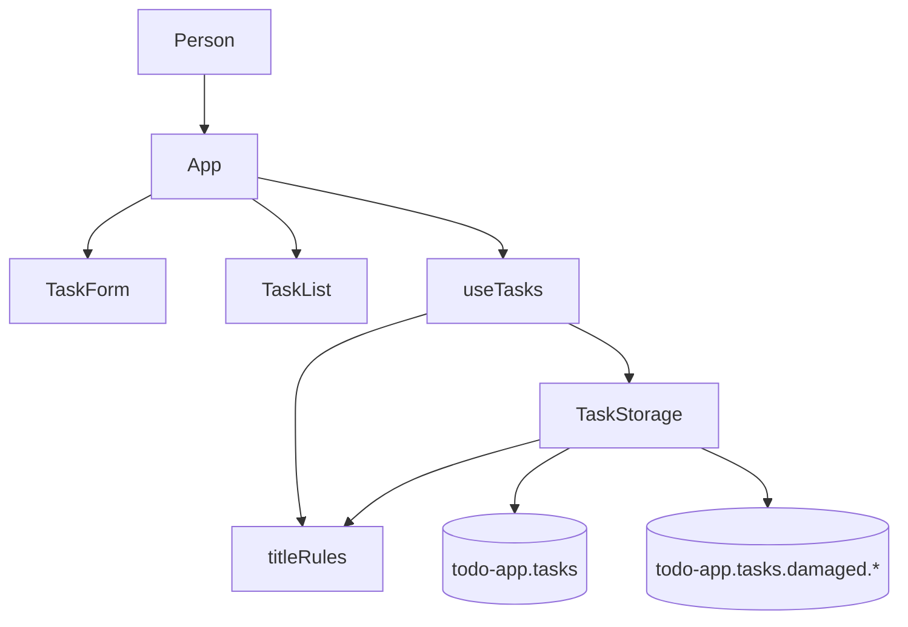

# Logical Components: add-task (U1), Todo List Frontend (Phase 1)

## Sources

- [desc] Initial description: "Todo list frontend using basic React (phase 1 of 2; backend comes in phase 2)"
- [scope] Workflow-selected scope: `mvp`.
- Performance and security designs of this Unit: `performance-design.md` and `security-design.md` in this folder.
- Functional design and component list: `aidlc/spaces/default/intents/261015-todo-frontend/construction/add-task/functional-design/functional-spec.md` and `frontend-components.md`
- Component catalogue: `aidlc/spaces/default/intents/261015-todo-frontend/inception/domain-design/components.md`
- Contracts C1 to C5: `aidlc/spaces/default/intents/261015-todo-frontend/inception/contract-design/contract-summary.md`
- Answers recorded in `nfr-design-questions.md` in this folder, cited as [Q1] and [Q2].

Scope of this document: the logical pieces of the add-task Unit seen as a runtime picture, so that Infrastructure Design (the next design stage) and Code Generation know where each NFR control sits and what can fail together. There is no deployable service: the whole Unit is files that run in the person's browser.

## Inventory

| Piece | Kind | Runs where | Owns | Failure domain |
|-------|------|------------|------|----------------|
| Page shell (`App`) | Screen block | Browser tab | Page frame, the reading of the hook | The tab |
| Add form (`TaskForm`) | Screen block | Browser tab | The text being typed and its message | The tab |
| List (`TaskList`, `TaskItem`) | Screen blocks | Browser tab | Nothing | The tab |
| State hook (`useTasks`) | Hook | Browser tab | The list in memory, the notice, the "save is due" record | The tab |
| Storage service (`TaskStorage`) | Service | Browser tab | The saved list, the unreadable text and backup state, the shape check | The tab and the person's browser storage |
| Title rules (`titleRules`) | Service (pure) | Browser tab | The title check | The tab |
| Saved list | Data | Browser local storage | One stored value `todo-app.tasks` | The browser profile |
| Backups | Data | Browser local storage | Zero or more values `todo-app.tasks.damaged.<time>` | The browser profile |
| Build and test tools | Tooling | The developer's machine | Formatting, lint rules, tests, coverage, audit report | The developer's machine |

## Runtime picture

Text fallback: the person uses `App`, which shows `TaskForm` and `TaskList` and reads `useTasks`; `useTasks` uses `TaskStorage` and the title rules; `TaskStorage` uses the title rules and writes the saved list and the backups in browser storage.

## Where each NFR control sits

| Control | Piece | Requirement |
|---------|-------|-------------|
| Save after the row is drawn | `useTasks` (the "save is due" record and the after-draw step) | NFR1.1, NFR1.2 |
| One read at page open, one write per add | `useTasks`, `TaskStorage` | NFR1.5 |
| Plain-text display | `TaskItem` (and the lint rules) | NFR4.1 |
| Lint rules forbidding storage and network outside services | Build tooling | NFR5.2 |
| No outgoing requests | Whole Unit; checked by a test | NFR5.1 |
| Shape check on load and save | `TaskStorage` | NFR6.1 |
| All-or-nothing write | `TaskStorage` | NFR8.1 |
| Backup before overwriting unreadable data | `TaskStorage` | NFR8.2 |
| Labels, alert message, focus ring | `TaskForm`, page styles | NFR3.1 to NFR3.4 |
| Vulnerability report | Build tooling | NFR5.3 |
| Timing guard test, coverage floor, layered tests | Build tooling and tests | NFR1.3, NFR7.1, NFR7.2, NFR7.3 |

## Failure domains and blast radius

| Failure | Who is affected | What the person sees | Contained by |
|---------|-----------------|----------------------|--------------|
| Storage refuses access (`blocked`) | This browser only | Notice that tasks could not be loaded or a change could not be saved; the page keeps working in memory | Results from `TaskStorage`, notices in `useTasks` |
| Storage full | This browser only | Save-failed notice | Same |
| Saved list unreadable | This browser only | Load-failed notice, empty list, backup made at the next save | Shape check, backup rule |
| A bug in one screen block | This tab | The page may not draw; reload recovers; saved data is untouched unless the bug is in the save | Tests per layer |
| Another tab changes the saved list | Out of this Unit | Not handled until U6 | Not applicable |

There is no shared resource between people: each browser holds only its own data, so the blast radius of any failure is one person on one browser.

## Shared resources and isolation

- The one stored value `todo-app.tasks` is written only by `TaskStorage.save` and read only by `TaskStorage.load`.
- Backups are written once and never read by this Unit or changed afterwards.
- The title rules are pure; they share nothing.
- Later Units add blocks beside these without changing the pieces above: complete, edit and delete add actions to `useTasks` and `TaskStorage`'s update and remove, keeping the "save is due" record as the one way a save is started.

## Assumptions & Open Questions

- [assumption] "Browser tab" is the only runtime; there are no workers, services or hosting pieces in phase 1.
- [assumption] Infrastructure Design has little or nothing to add for this Unit, because nothing is deployed; the local build and preview are the only environment.
- Open question: whether Infrastructure Design should be skipped for the remaining Units. It is a conditional stage in the plan; the owner decides at its start.
