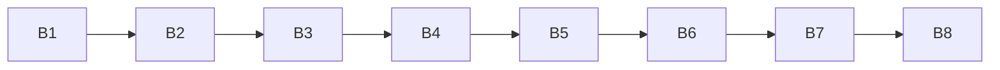

# Bolt Plan: Todo List Frontend (Phase 1)

## Sources

- [desc] Initial description: "Todo list frontend using basic React (phase 1 of 2; backend comes in phase 2)"
- [scope] Workflow-selected scope: `mvp`.
- Units, dependencies and story map: `aidlc/spaces/default/intents/261015-todo-frontend/inception/units-generation/unit-of-work.md`, `unit-of-work-dependency.md`, `unit-of-work-story-map.md`
- Requirements FR1 to FR9, NFR1 to NFR8: `aidlc/spaces/default/intents/261015-todo-frontend/inception/requirements-analysis/requirements.md`
- User stories US1.1 to US9.1: `aidlc/spaces/default/intents/261015-todo-frontend/inception/user-stories/stories.md`
- Component catalogue: `aidlc/spaces/default/intents/261015-todo-frontend/inception/domain-design/components.md`
- Contracts C1 to C5 and their open questions: `aidlc/spaces/default/intents/261015-todo-frontend/inception/contract-design/contract-summary.md`
- Team practices (walking skeleton, trunk-based development, test-after, 80% coverage): `aidlc/spaces/default/intents/261015-todo-frontend/inception/practices-discovery/team-practices.md`
- Answers recorded in `delivery-planning-questions.md` in this folder, cited as [Q1] to [Q6].

## What a Bolt is here

A **Bolt** is one build pass over one or more Units of Work, ending in something that runs and in one squash-merged commit on `main` named by the Bolt slug (team practice). The **walking skeleton** is the thin end-to-end slice that is built first so the whole thing is proven to hang together before features are added: here, adding a task and seeing it survive a reload. The Units are the nine pieces listed in `unit-of-work.md` (U1 add-task to U9 empty-guidance); this plan only orders them.

## Sequence at a glance

Eight Bolts, built one after another [Q2: B, Q3: A].

| Bolt | Unit(s) | Name | Size | Walking skeleton | Depends on |
|------|---------|------|------|------------------|------------|
| B1 | U1 | add-task | L | Yes | none |
| B2 | U2 | complete-task | S | No | B1 |
| B3 | U3 | delete-task | M | No | B1 |
| B4 | U4 | edit-task | M | No | B1 |
| B5 | U6 | keep-tasks | L | No | B1 |
| B6 | U5 | filter-tasks | S | No | B1, B2 |
| B7 | U7 | count-remaining | S | No | B1, B2 |
| B8 | U8 and U9 | storage-note and empty-guidance | S | No | B1 |

Text fallback: B1, B2, B3, B4, B5, B6, B7, B8, in that order. Every Bolt's prerequisites in the table come earlier in the sequence, so the order respects the dependency graph with no exceptions (see `risk-and-sequencing-rationale.md` for where it differs from number order).

## Before B1 starts

U6's two open decisions are settled at the start of Functional Design, before any U1 code is written [Q4: C]:

- what a save does after a failed save, including whether it may overwrite saved data that failed to load (requirement FR6.3 says to leave damaged data as it is);
- which block assigns an id when a create fails (contract C1 and C3 changed this from the storage service to the state hook).

U1's first save is built to that rule. These are decisions, not a Bolt; they are recorded in the Functional Design questions for U1.

## Bolt entries

### B1 add-task (U1, story US1.1): walking skeleton

- Marker: walking skeleton. It creates the project files, the page, the state hook, the storage service and the list that every other Bolt builds on.
- Includes: Prettier and ESLint configuration and the test setup (not present yet, per the team practices); TaskStorage create, list, save and load with the title rules; the state hook with the add action; the add row; the list and task rows in display form; the page wiring. Covers FR1.1 to FR1.7, FR6.1 and FR6.2 in their basic form, NFR1, NFR4, NFR6.
- Definition of Done: a person can type a title, press Enter or Add, and see it at the top of the list; empty, spaces-only and over-200-character titles are refused with their messages; after a reload the tasks are still there; titles with markup show as typed; Prettier and ESLint pass; the unit tests for each layer (storage, hook, components) pass with at least the happy path and two edge or error cases each; the full suite is green.
- Confidence hypothesis: shipping this proves the whole structure works end to end (the React page, the hook, the browser storage and the title rules) and that the speed target (under 100 ms for 100 tasks) holds, so every later Bolt is only an addition.
- Expected demo: open the app, add "Buy milk", see it at the top, reload, and see it still there.
- Proof command: the real project check that demonstrates this slice is chosen with you at the end of this stage (the Construction verification command step), not invented here.

### B2 complete-task (U2, story US2.1)

- Includes: the checkbox and the muted, struck-through look in the task row; the toggle action; the update operation in storage. Covers FR2.1 to FR2.3.
- Definition of Done: ticking and unticking works by mouse and by Space; a complete task is distinguishable without color; position does not change; tests pass and the suite is green.
- Confidence hypothesis: shipping this proves the update path through the hook and storage, which edit (B4) reuses.
- Expected demo: add three tasks, tick the second, see it styled and still second, reload and see it still ticked.

### B3 delete-task (U3, story US3.1)

- Includes: the Delete button, the new confirmation dialog, the pending-delete state, the remove action and the storage remove operation. Covers FR4.1 to FR4.3.
- Definition of Done: Delete asks "Delete this task?" with the title and Cancel focused first; Cancel and Esc keep the task; Delete removes it from the list and from the saved tasks; focus handling works; tests pass and the suite is green.
- Confidence hypothesis: shipping this proves the dialog pattern and focus handling, the first block that is not a plain list change.
- Expected demo: delete a task, cancel once, confirm once, reload and see it gone.

### B4 edit-task (U4, story US4.1)

- Includes: the in-place editing state of the task row, the edit action, and storage update with the title rules reused from B1. Covers FR3.1 to FR3.5.
- Definition of Done: Edit opens a field with the current title and focus; Enter saves, Esc cancels; refused titles show the same messages as adding; position and complete state are kept; tests pass and the suite is green.
- Confidence hypothesis: shipping this proves the title rules work at a second entry point and the task row can hold two display states.
- Expected demo: edit the second of three tasks, save with Enter, then cancel a second edit with Esc.

### B5 keep-tasks (U6, story US6.1)

- Includes: load and save failure results and messages, the shape check of saved data, all-or-nothing saving, notice of changes from other tabs, the message bar block and its placement. Covers FR6.1 to FR6.5, NFR5, NFR8.
- Definition of Done: unreadable saved data shows the message, starts empty and is left as it is; a blocked or failed save shows the message and leaves the earlier saved data readable; two tabs stay in sync; saved tasks hold exactly five fields; no task data leaves the browser; tests pass (including simulated failures) and the suite is green.
- Confidence hypothesis: shipping this proves the app tells the truth when the browser refuses to store or returns damaged data, which is the largest unusual-case logic in phase 1. If it is harder than planned, the remaining Bolts are still simple additions.
- Expected demo: replace the saved data with invalid text and reload to see the message and the preserved text; open two tabs and add a task in one.

### B6 filter-tasks (U5, story US5.1)

- Includes: the filter bar block, the filter state, and the "No tasks match this filter." message. Covers FR5.1 to FR5.4.
- Definition of Done: All, Active and Completed show the right tasks; the chosen filter is marked visually and as pressed; the filter is All after a reload; keyboard use works; tests pass and the suite is green.
- Confidence hypothesis: shipping this proves the list can be shown in a derived view without changing the saved order.
- Expected demo: one active and one complete task; switch through the three filters; reload and see All.

### B7 count-remaining (U7, story US7.1)

- Includes: the counter block and the derived count. Covers FR7.1 to FR7.3.
- Definition of Done: "N items left", "1 item left" and "0 items left" read correctly, update after every change, and do not depend on the filter; tests pass and the suite is green.
- Confidence hypothesis: shipping this proves the derived values stay correct across every earlier action (add, tick, delete, reload).
- Expected demo: three tasks, one ticked, the line reads "2 items left" under every filter.

### B8 storage-note and empty-guidance (U8 and U9, stories US8.1 and US9.1)

- Includes: the fixed "saved in this browser only" line under the title, and the "No tasks yet. Add one above." message in the list. Covers FR8.1 and FR9.1.
- Definition of Done: the line is visible with an empty and a full list; the empty message shows on a first visit and after the last task is deleted, with the count reading "0 items left"; tests pass and the suite is green.
- Confidence hypothesis: shipping this closes the first full pass of requirements FR1 to FR9; the final check is that every acceptance check in the stories passes together.
- Expected demo: first visit shows the empty message and the saved-in-this-browser line; add and delete one task to see both again.

## After B8

Build and Test (later stage) runs the whole suite, the coverage report against the 80% floor (NFR7), the browser checks (NFR2) and the keyboard and accessibility checks (NFR3), and the local production build check chosen in [Q5]. These are not Bolts; they are the next stages.

## Assumptions & Open Questions

- [assumption] Sizes are the relative sizes from `unit-of-work.md` (S, M, L). No day estimates are given, because none were agreed; the 7-day limit is a constraint to check at each Bolt, not a schedule.
- [assumption] B8 pairs U8 and U9 as chosen in [Q2]. Each still has its own Definition of Done above, so they can be separated later without replanning.
- Open question: the sequence is an order for the plan; the build order the workflow walks comes from the Unit dependency graph in `unit-of-work-dependency.md`, which lists independent Units in number order. Whether Construction can be made to follow B5 before U5 and U7 (rather than U5, U6, U7 in number order) is checked when Construction starts; if it cannot, the effect is only that U6 is built after U5 and U7, which the dependency graph allows.
- Open question: whether Prettier, ESLint and test setup should be a Bolt of their own instead of part of B1. Kept inside B1 because the first slice needs them to run its checks.
