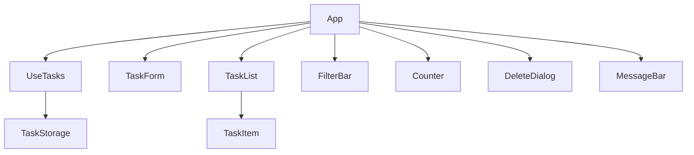

# Component Catalogue: Todo List Frontend (Phase 1)

## Sources

- [desc] Initial description: "Todo list frontend using basic React (phase 1 of 2; backend comes in phase 2)"
- [scope] Workflow-selected scope: `mvp`.
- Requirements: `aidlc/spaces/default/intents/261015-todo-frontend/inception/requirements-analysis/requirements.md`
- User stories: `aidlc/spaces/default/intents/261015-todo-frontend/inception/user-stories/stories.md`
- Refined mockups and interaction spec: `aidlc/spaces/default/intents/261015-todo-frontend/inception/refined-mockups/`
- Team practices and hard rules: `aidlc/spaces/default/intents/261015-todo-frontend/inception/practices-discovery/team-practices.md`
- Project document `docs/ARCHITECTURE.md` (stack, task shape, one-file-per-component, storage behind one service).
- Answers recorded in `domain-design-questions.md` in this folder, cited as [Q1] to [Q4]. Decisions are in `decisions.md` in this folder (ADR-001 to ADR-006).

Scope of this document: the building blocks to write and who owns what. How they are grouped for delivery is decided in Units Generation. Entities are shown at ownership and shape level only; types and validation rules belong to Functional Design.

## Part A: Component catalogue

Nine building blocks were chosen [Q1] (ADR-001). `App` is also listed because every block is wired together there and `docs/ARCHITECTURE.md` already names it; it holds no business rules and is not one of the nine.

```yaml
components:
  - name: TaskStorage
    summary: The only place that reads, writes and watches saved tasks in the browser, and the owner of the task shape and the title rules.
    behaviour: >
      Lists, creates, updates and removes tasks and keeps the saved list in the agreed shape
      (id, title, completed, createdAt, updatedAt). Assigns the id and the created and updated times.
      Applies the title rules (trim spaces, 1 to 200 characters) to every create and update and refuses
      an invalid title with a distinct reason (empty or too long). Writes a change completely or not at all.
      Reports distinctly when saved data cannot be read, when a save fails, and when another browser tab
      changed the saved tasks, without touching damaged data. Sends nothing outside the browser. This is the
      only block that touches browser storage or the network.
    responsibilities:
      - Persist and load the task list (FR6.1, FR6.2)
      - Own the Task shape, ids and timestamps (NFR6)
      - Enforce the title rules on create and update (FR1.1, FR1.3, FR1.4, FR3.4)
      - Report load and save failures and leave damaged data untouched (FR6.3, NFR8)
      - Notify subscribers when another tab changed the saved tasks (FR6.4)
      - Keep task data inside the browser (NFR5)
    depends_on: []
    dependents:
      - component: UseTasks
        interaction: UseTasks lists, creates, updates and removes tasks, and subscribes to changes from other tabs
    external_dependencies:
      - name: Browser local storage
        kind: other
        purpose: Holds each person's saved tasks in their own browser
      - name: Browser notification of storage changes from other tabs
        kind: other
        purpose: Lets the app notice that another tab changed the saved tasks
    entities:
      - name: Task
        identifier: id
        attributes: [id, title, completed, createdAt, updatedAt]
        references: []

  - name: UseTasks
    summary: The single place that holds the task list on screen, the chosen filter and the storage notice, and offers the actions.
    behaviour: >
      Holds the in-memory copy of the saved tasks (the saved list stays the source of truth), the chosen filter
      (All after every reload) and the current storage notice. Offers add, toggle complete, edit, delete and
      choose-filter actions that call TaskStorage, keep a task's position, and show a change on screen even if its
      save failed. Works out the filtered list and the count of incomplete tasks, which does not depend on the
      filter. Refreshes the list when TaskStorage reports a change from another tab. Raises the load-failed and
      save-failed notices. Holds no browser storage code.
    responsibilities:
      - Hold task, filter and notice state (FR5.1, FR5.4, FR6.3)
      - Offer the actions behind each story (FR1 to FR5)
      - Derive the visible list and the remaining count (FR5.1, FR7.1 to FR7.3)
      - Refresh when another tab changes tasks (FR6.4)
      - Turn storage results into screen state, including a change kept on screen after a failed save
    depends_on:
      - component: TaskStorage
        interaction: Reads and changes saved tasks and subscribes to changes from other tabs
        style: sync
    dependents:
      - component: App
        interaction: App reads the state and passes data and actions to the screen components
    external_dependencies: []
    entities:
      - name: Filter
        identifier: value
        attributes: [value]
        references: []
      - name: StorageNotice
        identifier: kind
        attributes: [kind, text]
        references: []

  - name: TaskForm
    summary: The title input and the Add button.
    behaviour: >
      Shows the input with its label and the Add button. Enter and Add behave the same. Hands the typed title to the
      add action, clears the input and keeps focus after a successful add, and shows the refusal message under the
      row without clearing the typed text when the title is refused. Holds no task data.
    responsibilities:
      - Collect a new title (FR1.1, FR1.5)
      - Show the empty-title and too-long messages in place (FR1.3, FR1.4)
      - Clear the input after a successful add (FR1.7)
    depends_on: []
    dependents:
      - component: App
        interaction: App renders it and passes the add action and any message
    external_dependencies: []
    entities: []

  - name: TaskList
    summary: Shows the tasks that match the filter, and the empty messages.
    behaviour: >
      Shows the visible tasks newest first, one TaskItem each, or "No tasks yet. Add one above." when there are no
      tasks, or "No tasks match this filter." when tasks exist but none match. The whole page scrolls for long lists.
    responsibilities:
      - Render the visible list in order (FR1.2)
      - Show the two empty messages (FR9.1, FR5.3)
    depends_on:
      - component: TaskItem
        interaction: Renders one TaskItem for each visible task
        style: sync
    dependents:
      - component: App
        interaction: App renders it and passes the visible tasks and actions
    external_dependencies: []
    entities: []

  - name: TaskItem
    summary: One task row, with checkbox, title, Edit and Delete, and the inline title edit.
    behaviour: >
      Shows the checkbox and title (muted and struck through when complete), and the Edit and Delete buttons. Edit
      turns the title into an input with Save and Cancel; Enter saves and Esc cancels; a refused title shows the same
      messages as the add form. Delete asks the app to confirm and removes nothing itself. Long titles wrap. Titles
      are shown as plain text. Holds only the text being edited.
    responsibilities:
      - Show a task and its complete state (FR2.1, FR2.2)
      - Edit a title in place (FR3.1 to FR3.4)
      - Ask for a delete to be confirmed (FR4.1)
      - Show titles as plain text and wrap long ones (NFR4)
    depends_on: []
    dependents:
      - component: TaskList
        interaction: TaskList renders one for each visible task
    external_dependencies: []
    entities: []

  - name: FilterBar
    summary: The All, Active and Completed buttons.
    behaviour: >
      Shows the three buttons, marks the chosen one visually and as pressed, and reports a choice. Holds no filter
      state of its own.
    responsibilities:
      - Offer and mark the chosen filter (FR5.1, FR5.2)
    depends_on: []
    dependents:
      - component: App
        interaction: App renders it and passes the chosen filter and the choose action
    external_dependencies: []
    entities: []

  - name: Counter
    summary: The line "N items left".
    behaviour: >
      Shows the number of incomplete tasks in the form "N items left", "1 item left" or "0 items left", announced
      politely when it changes. Receives the number; works nothing out itself.
    responsibilities:
      - Show the remaining count with the right wording (FR7.1, FR7.2)
    depends_on: []
    dependents:
      - component: App
        interaction: App renders it and passes the count
    external_dependencies: []
    entities: []

  - name: DeleteDialog
    summary: The "Delete this task?" question over the list.
    behaviour: >
      Shows the heading, the task's title, and Cancel and Delete. Cancel has focus first, focus stays inside while it
      is open, Esc and Cancel close it without deleting, and clicking the dimmed area does nothing. Returns focus to the
      task's Delete button when it closes without deleting.
    responsibilities:
      - Ask for confirmation before a delete (FR4.1, FR4.3)
    depends_on: []
    dependents:
      - component: App
        interaction: App opens it for the task being confirmed and passes the delete action
    external_dependencies: []
    entities: []

  - name: MessageBar
    summary: The line above the add row for the two storage messages.
    behaviour: >
      Shows "Your tasks could not be loaded." (until reload) or "Your change could not be saved." (until the next
      successful save), in danger color with a "(!)" mark, announced to screen readers as an alert. Shows nothing
      otherwise.
    responsibilities:
      - Show the load-failed and save-failed notices (FR6.3)
    depends_on: []
    dependents:
      - component: App
        interaction: App renders it and passes the current notice
    external_dependencies: []
    entities: []

  - name: App
    summary: The composition root that wires the state to the screen blocks and shows the browser-only line.
    behaviour: >
      Reads UseTasks once and passes data and actions to the screen blocks, which stay presentational. Holds the task
      currently being confirmed for deletion. Shows the page title and the always-visible line "Your tasks are saved in
      this browser only", placed under the title. Holds no business rules.
    responsibilities:
      - Wire state to the screen blocks (ADR-004)
      - Hold which task is being confirmed for deletion
      - Show the page title and the browser-only line (FR8.1)
    depends_on:
      - component: UseTasks
        interaction: Reads the state and the actions
        style: sync
      - component: TaskForm
        interaction: Renders the add row
        style: sync
      - component: TaskList
        interaction: Renders the visible tasks
        style: sync
      - component: FilterBar
        interaction: Renders the filter buttons
        style: sync
      - component: Counter
        interaction: Renders the remaining count
        style: sync
      - component: DeleteDialog
        interaction: Opens the delete question for one task
        style: sync
      - component: MessageBar
        interaction: Renders the current notice
        style: sync
    dependents: []
    external_dependencies: []
    entities: []
```

## Component Diagram



Text fallback: App calls UseTasks and renders TaskForm, TaskList, FilterBar, Counter, DeleteDialog and MessageBar; TaskList renders TaskItem; UseTasks calls TaskStorage. There are no other dependencies and no cycles.

## Component Summary

| Component | Purpose | Depends On | Dependents | Entities Owned |
|-----------|---------|------------|------------|----------------|
| TaskStorage | Saves, loads and watches tasks; owns the task shape and title rules | none | UseTasks | Task |
| UseTasks | Holds list, filter and notice; offers the actions | TaskStorage | App | Filter, StorageNotice |
| TaskForm | Add input and button | none | App | none |
| TaskList | Visible list and empty messages | TaskItem | App | none |
| TaskItem | One task row and its inline edit | none | TaskList | none |
| FilterBar | All, Active, Completed buttons | none | App | none |
| Counter | "N items left" | none | App | none |
| DeleteDialog | "Delete this task?" question | none | App | none |
| MessageBar | Load and save failure messages | none | App | none |
| App | Wires everything; browser-only line | UseTasks, TaskForm, TaskList, FilterBar, Counter, DeleteDialog, MessageBar | none | none |

## Entity Ownership

| Entity | Owning Component | Identifier | Attributes | References |
|--------|------------------|------------|-----------|------------|
| Task | TaskStorage | id | id, title, completed, createdAt, updatedAt | none |
| Filter | UseTasks | value | value (All, Active or Completed) | none |
| StorageNotice | UseTasks | kind | kind (load failed or save failed), text | none |

The list of tasks held by UseTasks is a copy of the saved list, not a second owner of Task. The saved list is the source of truth (ADR-006).

## External Dependencies

| Component | Dependency | Kind | Purpose |
|-----------|-----------|------|---------|
| TaskStorage | Browser local storage | other | Holds each person's saved tasks |
| TaskStorage | Browser notification of storage changes from other tabs | other | Lets the app notice another tab's changes |

## Rationale

| Component | Why it is a separate building block |
|-----------|-------------------------------------|
| TaskStorage | The one place that touches storage (team hard rule); changes when the storage changes, which is exactly what phase 2 replaces |
| UseTasks | One owner of what is on screen; changes when behavior changes, not when layout changes |
| TaskForm | Own concern (collecting a title); own states (error, filled) |
| TaskList | Own concern (what is visible and the empty messages); changes with filtering |
| TaskItem | Own lifecycle (display, editing); changes with the row design |
| FilterBar | Own concern; always changes separately from the count |
| Counter | Own concern; trivial, but changes for a different reason than FilterBar [Q1] |
| DeleteDialog | Own focus and keyboard behavior; keeps TaskItem small [Q1] |
| MessageBar | One place for the two storage messages, shown above the add row |
| App | Wiring only, so the other blocks stay presentational |

Alternatives Rejected for the decomposition: merging FilterBar and Counter into one SummaryBar, and keeping the delete question inside TaskItem. Both are recorded in ADR-001.

## Assumptions & Open Questions

- [assumption] `App` is listed as a tenth entry because the wiring has to live somewhere and `docs/ARCHITECTURE.md` names it; the nine blocks chosen in Q1 are the other nine entries.
- [assumption] The Filter and StorageNotice entities are screen state owned by UseTasks, listed so every piece of shared state has one owner. They are not saved.
- [assumption] The text being typed in the add input or the edit field is local to TaskForm and TaskItem and is not a shared entity.
- Open question: with title rules inside TaskStorage [Q2], the phase 2 swap of the storage service would also have to carry the title rules, which `docs/ARCHITECTURE.md` does not expect ("only this file changes"). One way to avoid it is a separate rules file inside the services folder that TaskStorage calls; this is not agreed. Left for Functional Design.
- Open question: TaskStorage has three jobs (saving, title rules, watching other tabs). Left for Functional Design to keep them as separate files inside the services folder if it helps.
- Open question: the edits needed in `docs/ARCHITECTURE.md` are listed in `decisions.md` for the owner to make [Q4].
- Open question: the two situations flagged in earlier stages (a tab acting on a task another tab removed, and a rapid double submit) have no owner block yet. Left for Functional Design.
