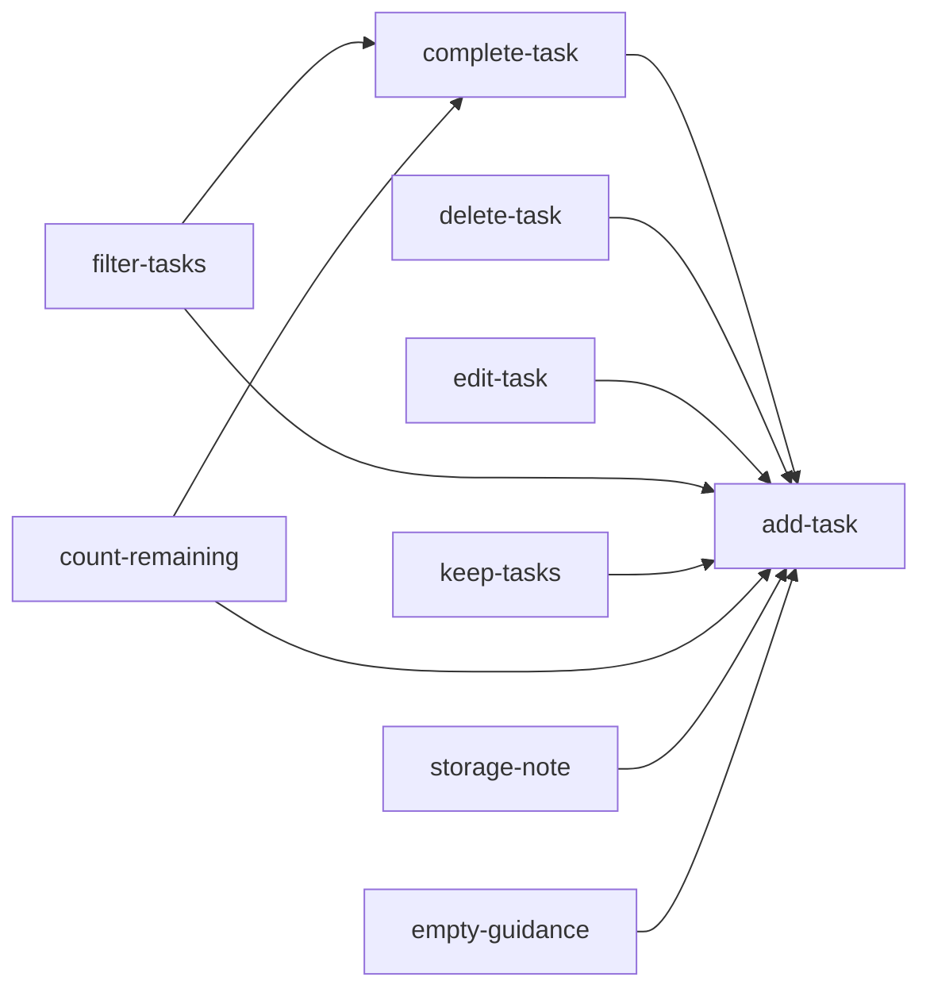

# Unit Dependencies: Todo List Frontend (Phase 1)

## Sources

- [desc] Initial description: "Todo list frontend using basic React (phase 1 of 2; backend comes in phase 2)"
- [scope] Workflow-selected scope: `mvp`.
- Units: `unit-of-work.md` in this folder.
- Component catalogue and decisions: `aidlc/spaces/default/intents/261015-todo-frontend/inception/domain-design/components.md` and `decisions.md`
- Team practices: `aidlc/spaces/default/intents/261015-todo-frontend/inception/practices-discovery/team-practices.md`
- Answers recorded in `units-generation-questions.md` in this folder, cited as [Q1] to [Q4].

This document describes what can depend on what. It does not choose a build order or a critical path; that is decided in Delivery Planning.

## Dependency graph

An arrow reads "depends on".



Text fallback:

- add-task depends on nothing.
- complete-task, delete-task, edit-task, keep-tasks, storage-note and empty-guidance each depend on add-task.
- filter-tasks and count-remaining each depend on add-task and complete-task.
- There are no cycles.

## Edge block

```yaml
units:
  - name: add-task
    kind: ui
    depends_on: []
  - name: complete-task
    kind: ui
    depends_on: [add-task]
  - name: delete-task
    kind: ui
    depends_on: [add-task]
  - name: edit-task
    kind: ui
    depends_on: [add-task]
  - name: filter-tasks
    kind: ui
    depends_on: [add-task, complete-task]
  - name: keep-tasks
    kind: ui
    depends_on: [add-task]
  - name: count-remaining
    kind: ui
    depends_on: [add-task, complete-task]
  - name: storage-note
    kind: ui
    depends_on: [add-task]
  - name: empty-guidance
    kind: ui
    depends_on: [add-task]
```

## Why each dependency exists

| Unit | Depends on | Reason |
|------|-----------|--------|
| complete-task | add-task | A task must exist, and the task row and the state hook must exist, before a task can be ticked |
| delete-task | add-task | Needs the task row, the list and the storage service created there |
| edit-task | add-task | Needs the task row and the title rules created there |
| filter-tasks | add-task, complete-task | The filter only has something to show when tasks exist in both states |
| keep-tasks | add-task | Builds on the storage service created there, adding failure handling and tab sync |
| count-remaining | add-task, complete-task | The count is the number of tasks not ticked, so it needs both |
| storage-note | add-task | The line sits in `App`, which is created there |
| empty-guidance | add-task | The message sits in `TaskList`, which is created there |

## Integration points between units

| Between | What is shared |
|---------|----------------|
| every unit and add-task | The page frame (`App`), the state hook (`UseTasks`), the storage service (`TaskStorage`), the list (`TaskList`, `TaskItem`) and the Task shape (id, title, completed, createdAt, updatedAt) |
| complete-task, edit-task, delete-task and TaskStorage | The update and remove operations on saved tasks |
| filter-tasks, count-remaining and complete-task | The task's complete state |
| keep-tasks and add-task, complete-task, edit-task, delete-task | The save step they all go through; failures raised by keep-tasks apply to every change |

There are no APIs, events or services between units: the contracts are the function inputs and outputs of the shared blocks, which are pinned in the next stage (Contract Design) and in Functional Design.

## First unit and how it runs before the others

The first unit in the graph is add-task: it is the only unit with no dependencies. It is the thin end-to-end slice the team agreed on. It can run before any other unit exists because it creates the page, the state hook, the storage service and the list itself: a person can add a task, see it, and find it again after a reload. It needs none of the other eight units to do that; they add behavior on top of the files it creates.

## Parallel development opportunities

Once add-task exists, the following units do not depend on each other, so more than one valid ordering exists and a different developer can take each [Q4]:

- Set 1 (all depend only on add-task): complete-task, delete-task, edit-task, keep-tasks, storage-note, empty-guidance.
- Set 2 (need complete-task as well as add-task): filter-tasks and count-remaining; they do not depend on each other.

Caution: independence in the graph is not independence in the files. Several units edit the same files, so two developers working on them at once are likely to conflict on merge, which the team practice of short-lived branches squashed into `main` makes visible quickly:

| File or block | Units that change it |
|---------------|----------------------|
| `App` | add-task, delete-task, filter-tasks, keep-tasks, count-remaining, storage-note, empty-guidance |
| `UseTasks` | add-task, complete-task, delete-task, edit-task, filter-tasks, keep-tasks, count-remaining |
| `TaskItem` | add-task, complete-task, delete-task, edit-task |
| `TaskStorage` | add-task, complete-task, delete-task, edit-task, keep-tasks |
| `TaskList` | add-task, filter-tasks, empty-guidance |

`docs/ARCHITECTURE.md` already asks that the files a task will touch are listed in `TASKS.md` before editing; that applies here.

## Assumptions & Open Questions

- [assumption] storage-note and empty-guidance depend on add-task only because `App` and `TaskList` are created there; as ideas they would be independent.
- Open question: how to reduce the shared-file conflicts (for example by splitting `UseTasks` or `TaskItem` into smaller files). Left for Delivery Planning and Functional Design.
- Open question: whether keep-tasks should wait until the failed-save decision from Domain Design is made, since it depends on it. Left for Delivery Planning.
